

  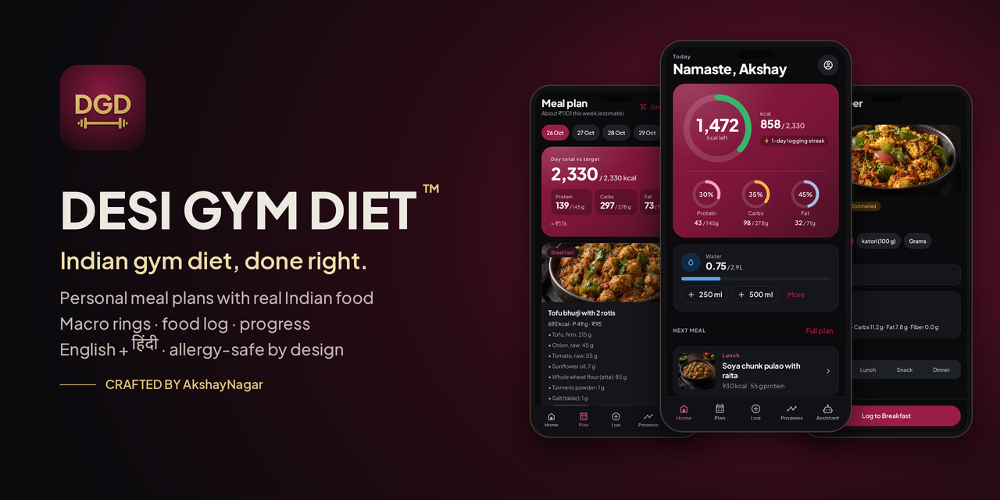

  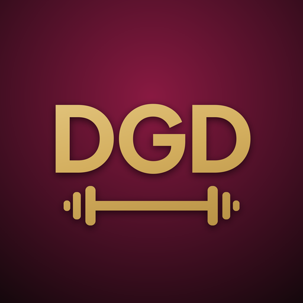 
  <b>DESI GYM DIET™</b> 
  <i>Gym diet planning with real Indian food: personal calorie and protein targets, desi meal plans and a food log, in English, Hinglish and हिंदी.</i>

  
  
  
  
  

  
  &nbsp;
  

---

## Screenshots

<table>
  <tr>
    <td align="center">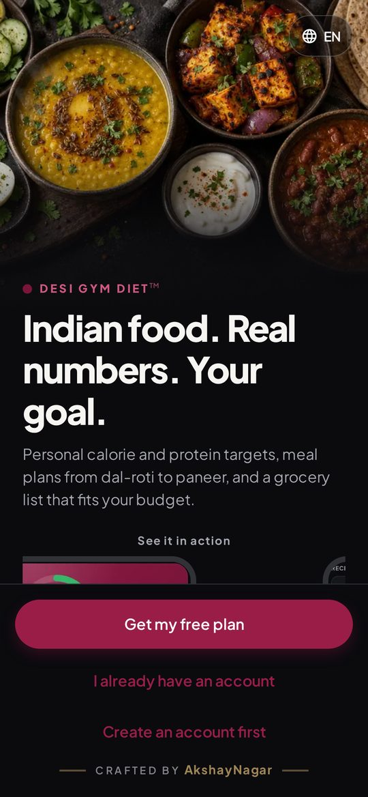 Welcome</td>
    <td align="center">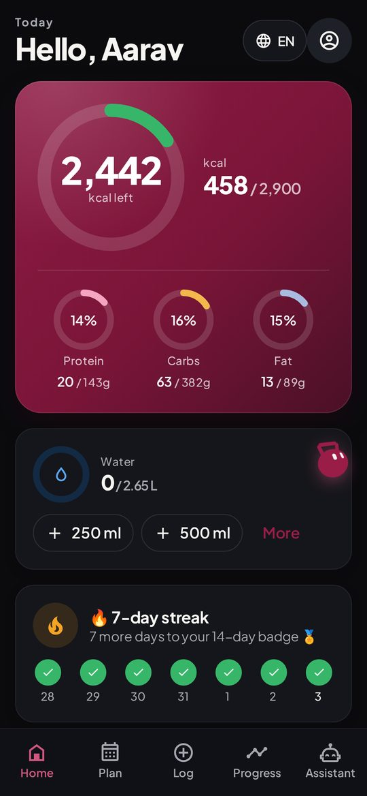 Home: macro rings</td>
    <td align="center">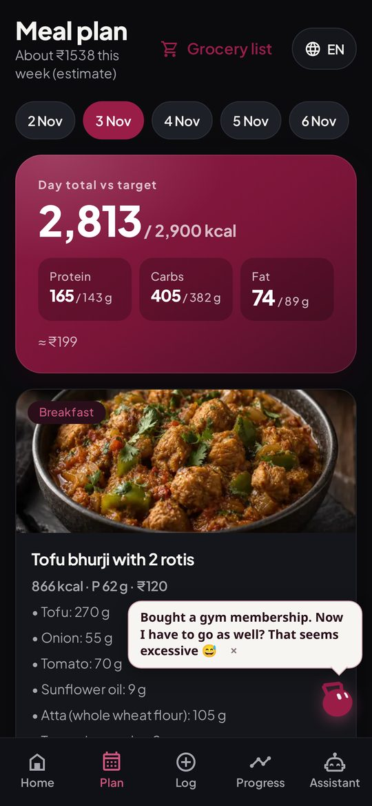 Indian meal plan</td>
    <td align="center">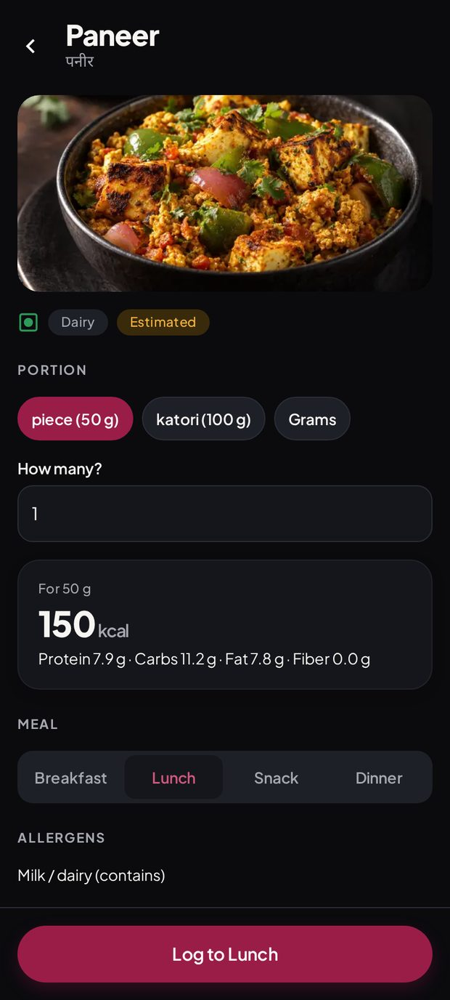 Food detail</td>
  </tr>
  <tr>
    <td align="center">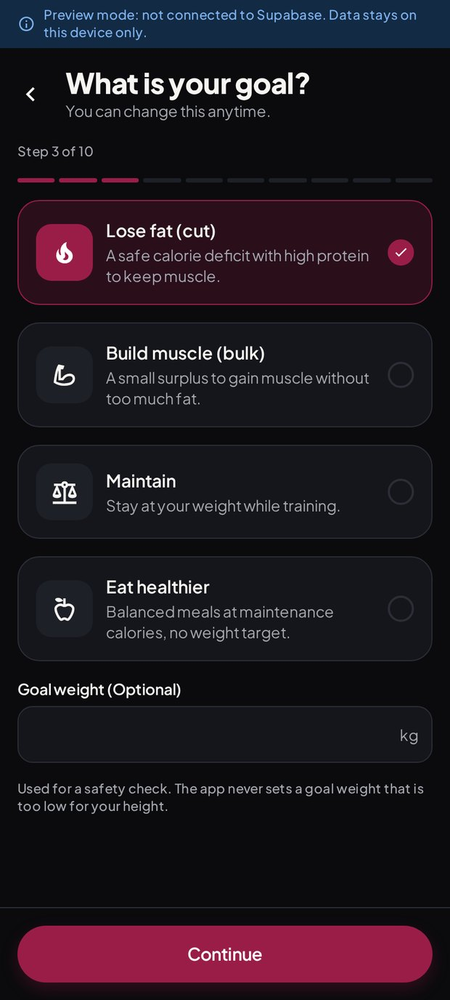 Choose your goal</td>
    <td align="center">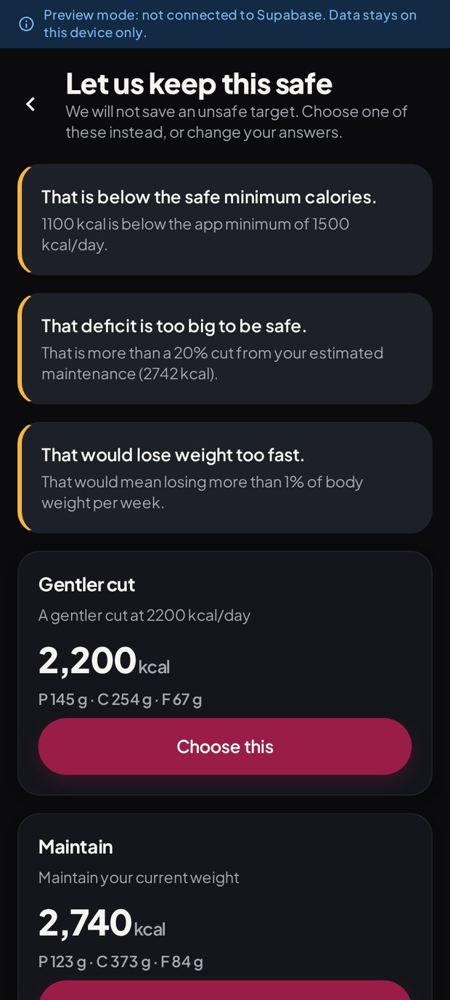 Safe targets only</td>
    <td align="center">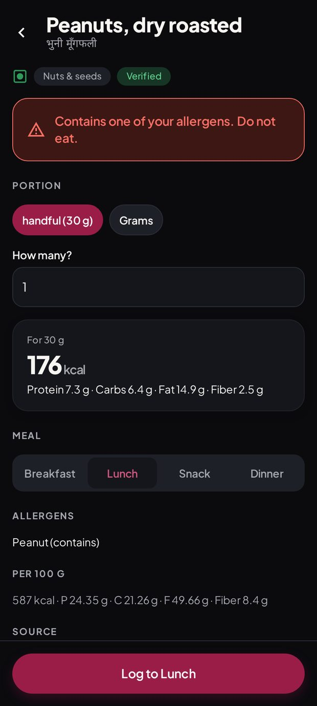 Allergy warning</td>
    <td align="center">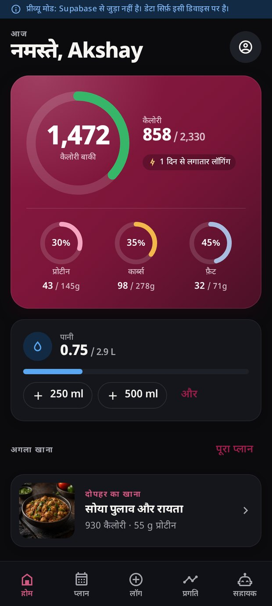 हिंदी में</td>
  </tr>
  <tr>
    <td align="center">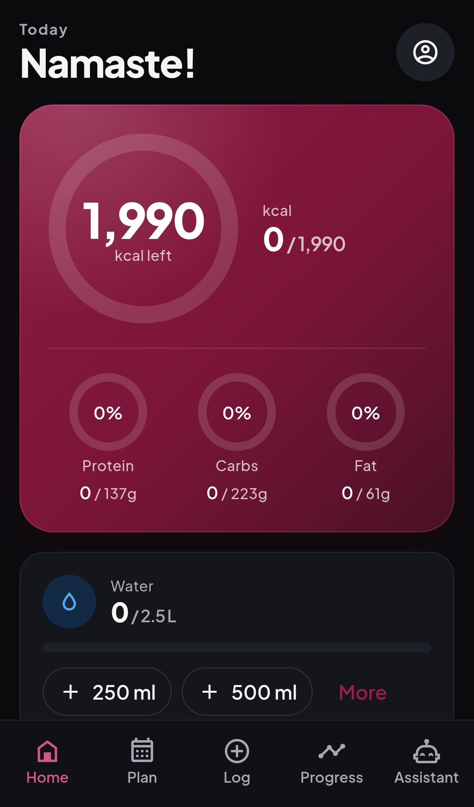 iPhone web app</td>
    <td align="center">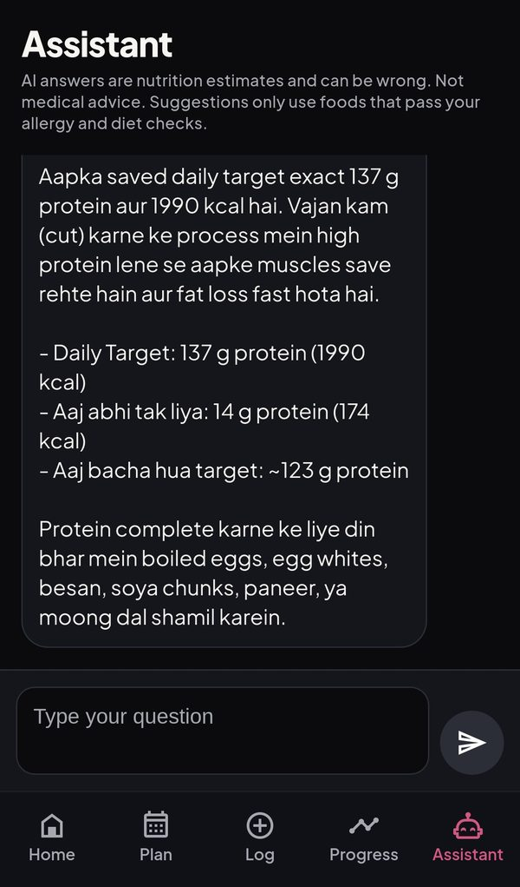 AI assistant (Hinglish)</td>
    <td align="center">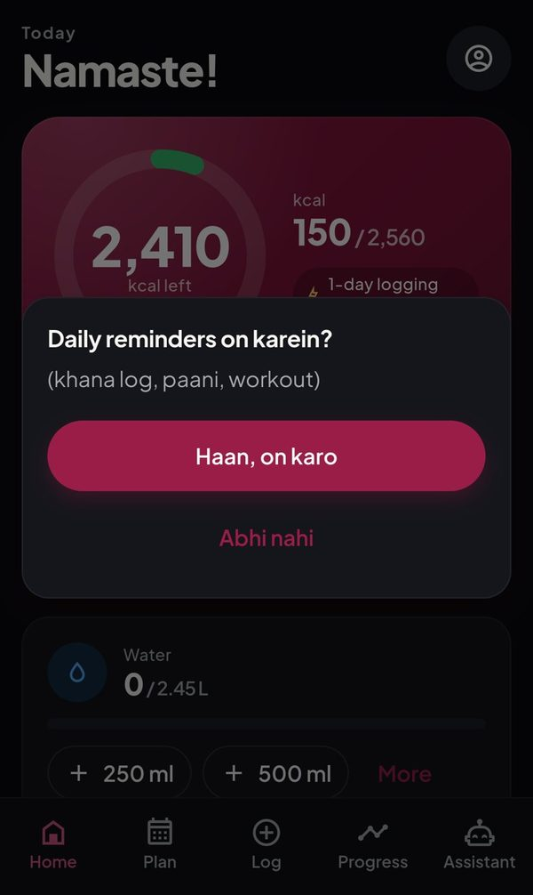 Daily reminders (web)</td>
    <td></td>
  </tr>
</table>

## Download for Android

**[⬇ Download DesiGymDiet.apk (v1.0.10, 87 MB)](https://github.com/iashwani69-code/desi-gym-diet-app/releases/latest/download/DesiGymDiet.apk)** · Android 7.0 or newer · [all releases](https://github.com/iashwani69-code/desi-gym-diet-app/releases)

1. Open the download link on your Android phone. Chrome saves `DesiGymDiet.apk`.
2. Tap the downloaded file (or open it from **Files → Downloads**).
3. If Android asks, allow **Install unknown apps** for Chrome or your Files app (one-time).
4. Tap **Install**, then **Open**.

**Tips**

- **Play Protect warning?** It appears for apps installed from outside the Play Store. Tap **More details → Install anyway**.
- **Updating:** install the newer APK over the old one. No need to uninstall; your data stays in your account.
- Each release lists the APK's SHA-256 checksum if you want to verify the file.

## iPhone (web app)

No App Store needed. Open **[dgd-app.pages.dev](https://dgd-app.pages.dev/)**:

1. Open **[the link](https://dgd-app.pages.dev/)** in **Safari**.
2. Tap **Share** (the square with the arrow).
3. Tap **Add to Home Screen**.
4. Open **Desi Gym Diet** from the new icon on your home screen.
5. **Sign up**, or **log in with the same account you use on Android**. Your data syncs.

The web app also works in any modern browser on a laptop or Android phone. (The step tracker is Android-only: iPhone web apps cannot read the phone's step count.)

## Features

- **Personal targets.** Calories, protein, carbs, fat, fibre and water, calculated from your body, goal and activity
  (Mifflin-St Jeor). Unsafe targets are refused, and you get safe alternatives to pick from.
- **Indian meal plans.** A weekly plan for 2–6 meals a day: veg, eggetarian, non-veg or vegan, within your budget and
  cooking time. Swap any meal in one tap.
- **Allergy-safe by design.** Plans, swaps and grocery lists are checked against your allergies and intolerances,
  including local names like “groundnut”, “jhinga” and “maida”.
- **Food log and macro rings.** Today's calories, protein, carbs and fat at a glance. Log food, water and weight.
- **Food search in English, Hindi and Hinglish.** 140 foods and 346 Indian recipes (recipe nutrition is estimated from ingredients).
  On Android, search and logging also work offline.
- **AI assistant.** Ask about protein, swaps and meals in English, Hinglish or Hindi. Answers are nutrition estimates, not medical advice.
- **Progress.** 7, 30 and 90-day trends for calories, protein, water and weight, plus a logging streak.
- **Grocery list and pantry.** Built from your plan, minus what you already have.
- **Units.** kg with height in feet/inches, or lb with height in inches.
- **Apni bhasha: English, Hinglish or हिंदी.** Pick on first open, switch any time with the 🌐 button (EN / Hi / हि) on every screen.
  The whole app, Damru's tips and reminder notifications follow your choice.
- **Step tracker (Android).** Choose your own daily goal (5,000 / 7,000 / 10,000 / 12,000 or any number), see a steps ring
  on Home, get a 7 PM nudge if steps are left, and a "Hurrah! 🎉" from Damru when you hit it. Steps stay on your phone.
- **Damru, your desi gym buddy.** Useful tips on every screen, the odd desi joke, and a small hint for each field while you type.

## Reminders and notifications

- **Personal reminders (Android + web):** set your own wake-up and sleep time, meal and workout times in
  **Settings → Reminders**. Defaults are filled in for your goal (fat loss / muscle gain / maintain); water reminders come
  every hour, only while you are awake.
- **iPhone / web app:** the app asks once whether to turn on reminders. Tap **Haan, on karo** and allow notifications.
  On iPhone, notifications need iOS 16.4 or newer and work only when the app is opened from its Home Screen icon.
- **Steps (Android):** if your steps goal is not done by 7 PM, a gentle reminder (never in quiet hours).
- Turn any reminder off any time in **Settings → Reminders**.

## Privacy and security

- **Your data is private to your account.** Every private table uses Row Level Security, so an account can only read
  and change its own rows. This was checked with separate test accounts.
- **No secret keys in the app or website.** Only the public, low-privilege client key ships with the app. The AI key
  stays on the server.
- **AI is behind login.** The assistant answers only signed-in users, with a daily limit per user.
- **Web reminders store the minimum.** The reminder server keeps only your browser's push subscription and reminder
  times, with no name or email.
- **HTTPS with security headers** (Content-Security-Policy, no framing) on the web app.
- **No ads, and your data is not sold.** Export your data or permanently delete your account from **Settings** at any time.

## Health disclaimer

Desi Gym Diet gives general fitness and nutrition guidance. **It is not medical advice.** Targets are estimates. If you
are pregnant or breastfeeding, under 18, or have diabetes, kidney, heart or any other medical condition or an eating
disorder, talk to a doctor or a registered dietitian before changing your diet.

## Version

**What's new in v1.0.10 (Android + web / iPhone):**
- **Apni bhasha chuno:** English, Hinglish ya हिंदी. Pehli baar app kholne pe chooser aata hai (English pehle se selected), aur har screen ke upar 🌐 button (EN / Hi / हि) se kabhi bhi badlo. Poora app, Damru ki tips aur jokes, field hints aur reminder notifications, sab aapki chuni bhasha mein.
- **Step tracker (sirf Android):** roz ka steps goal aap khud chuno (5,000 / 7,000 / 10,000 / 12,000 ya apna number; kabhi bhi badlo), Home pe steps ring, steps baaki hon toh shaam 7 baje reminder (quiet hours mein nahi), goal pura hone pe Damru ka "Hurrah! 🎉". Steps sirf aapke phone pe rehte hain; calories sirf andaza hain.
- **Naya look:** warm gradient header cards, paani ka progress ring, khaali screens pe Damru, Physical Activity (step permission) ka naya popup.

Install the new APK over the old app; your login and data stay. v1.0.9 users: the app shows "Naya update aaya hai" by itself.

**What's new in v1.0.9 (Android + web):**
- **Personal reminders:** apna uthne-sone ka time, meals aur workout ka time khud set karo. Goal (fat loss / muscle gain / maintain) ke hisaab se default times pehle se bhare milte hain (research-based); paani har ghante, sirf jaagte waqt. Settings → Reminders. Settings sirf aapke phone pe save hoti hain.
- **Damru v2:** har screen pe kaam ki tip, beech-beech mein desi jokes 😄, keyboard khulte hi Damru keyboard ke upar aa jata hai aur har field ke liye chhota hint deta hai (email, password, height, weight...). Kabhi kisi button ya field ke upar nahi baithta.
- Keyboard khulne pe screen ab upar khisakti hai, likhte waqt field dikhta rahe.

See [Releases](https://github.com/iashwani69-code/desi-gym-diet-app/releases) for the full history.

## Credits

The mascot artwork (Damru) was made with [Bible Strong Avatar Lab](https://github.com/smontlouis/bible-strong-avatar-lab)
by Stéphane Montlouis-Calixte (@_smontlouis), licensed under
[AGPL-3.0](https://www.gnu.org/licenses/agpl-3.0.html). The credit is also shown in the app under **Settings → About**.

## Feedback

Questions, feedback or a bug? Open an [issue](https://github.com/iashwani69-code/desi-gym-diet-app/issues).

---

  <b>DESI GYM DIET™</b> · Crafted by <b>Akshay Nagar</b> 
  © 2026 Akshay Nagar. All rights reserved. The app and its own source code are proprietary; see <a href="LICENSE">LICENSE</a>. The mascot artwork is third-party and stays under its AGPL-3.0 license (see Credits above).

