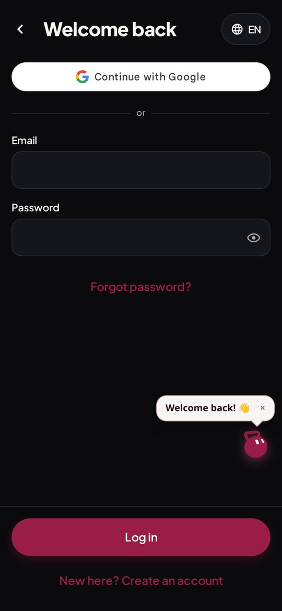
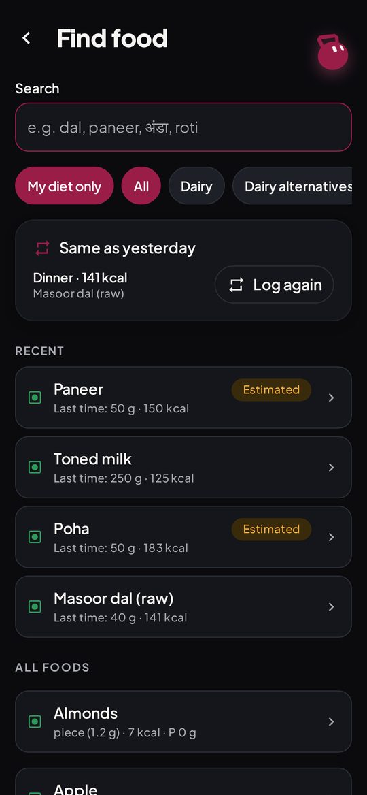
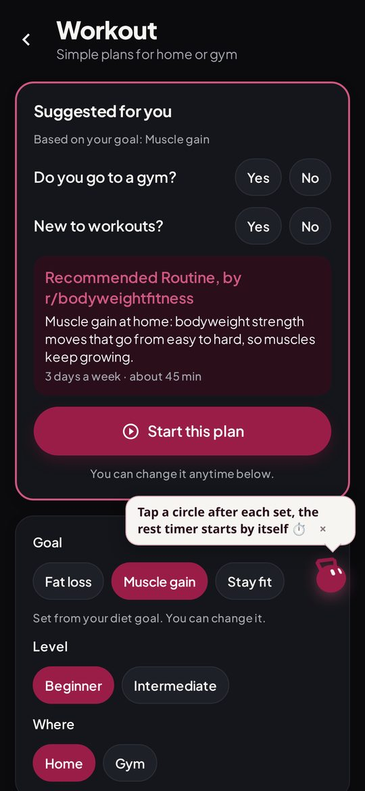
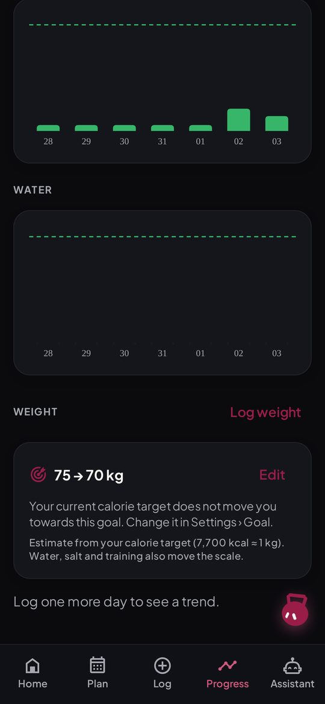
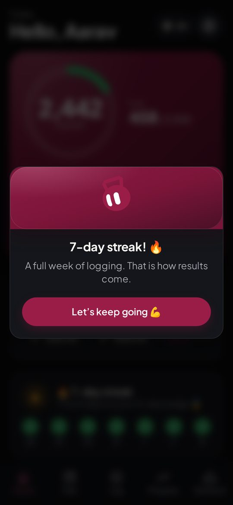
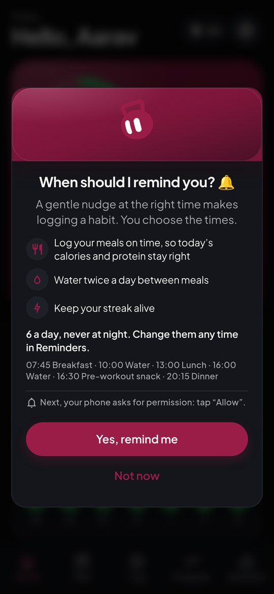

  

   
  <b>DESI GYM DIET™</b> 
  <i>Gym diet planning with real Indian food: personal calorie and protein targets, desi meal plans and a food log, in English, Hinglish and हिंदी.</i>

  
  
  
  
  

  
  &nbsp;
  

---

## What's new in v1.1.0

- **Continue with Google.** One-tap sign-in on Android, the iPhone web app and the website. Email and password still work.
- **Your plan first, account later.** Answer a few questions, see your free plan and daily targets, then save it with an account.
- **Email confirmation.** New email accounts confirm their address before the first login.
- **Streak on Home.** Your logging streak is on the Home screen, and Damru celebrates your milestones.
- **Faster logging.** Recent foods at the top of search, "Same as yesterday" in one tap, and a "Logged ✓ (Undo)" confirmation.
- **Target weight.** Set a goal weight and see roughly when you will get there at a safe pace.
- **Workouts.** A Workout tab with well-known beginner programs (StrongLifts 5×5, PHUL, 7-Minute Workout, a bodyweight routine), sets / reps / kg logging and a rest timer. A finished workout counts for your streak.
- **Reminders that fit your day.** Damru asks when to remind you: about 6 a day by default, never at night.
- **Health Connect (Android, optional).** Steps can add the calories you burned to Home.
- **Security fixes.** Logging out now clears this device's saved data, and the Android app asks for fewer permissions.

## Screenshots

<table>
  <tr>
    <td align="center"> Log in with Google or email</td>
    <td align="center"> Home: streak, macros, workout</td>
    <td align="center"> Indian meal plan</td>
  </tr>
  <tr>
    <td align="center"> Recent foods + "Same as yesterday"</td>
    <td align="center"> Workout programs</td>
    <td align="center"> Target weight and date</td>
  </tr>
  <tr>
    <td align="center"> Welcome: plan first</td>
    <td align="center"> Damru celebrates a streak</td>
    <td align="center"> Damru asks when to remind you</td>
  </tr>
</table>

Screenshots from the v1.1.0 web app on a phone, English UI.

## Why Desi Gym Diet is different

- **Built around Indian food.** Plans, swaps and logging use dal, roti, sabzi, paneer, eggs and 346 Indian recipes, with katori and roti-style portions, not imported meal templates.
- **Your language.** The whole app works in English, Hinglish or हिंदी, and food search understands Hindi and Hinglish names.
- **Free, with no ads.** No subscription is needed for the plan, the log, workouts or reminders, and your data is not sold.
- **Clear about the maths.** The targets screen shows how your calories and protein were calculated (Mifflin-St Jeor), and unsafe targets are refused.
- **Allergy checks everywhere.** Plans, swaps and grocery lists are checked against your allergies, including local names like "groundnut", "jhinga" and "maida".
- **Budget-aware.** Plans can stay within a daily ₹ budget and your cooking time, and the grocery list skips what is already in your pantry.
- **Works offline on Android.** Food search and logging keep working without internet.
- **Privacy checked before release.** Each account can only see its own data, the app carries no secret keys, and new accounts confirm their email. These were tested with separate test accounts before v1.1.0 went live.
- **A coach with personality.** Damru gives short, useful tips on every screen instead of long articles.

## Meet Damru

  
  &nbsp;&nbsp;
  

Damru is the app's mascot: a cheerful kettlebell and your desi gym buddy.

- **Tips on every screen.** A short, useful line for the screen you are on, with the odd desi joke.
- **Smart hints from your own numbers.** For example, how much protein is left today.
- **Field hints while you type.** On Android he sits just above the keyboard with a hint for the field you are filling.
- **Reminders and celebrations.** He asks when you want reminders and celebrates your streak milestones.
- **Never in the way.** He steps aside when a popup is open, and a long-press hides him.

Mascot art based on Bible Strong Avatar Lab by @_smontlouis (AGPL-3.0).

## Download for Android

**[⬇ Download DesiGymDiet.apk (v1.1.0, 88 MB)](https://github.com/iashwani69-code/desi-gym-diet-app/releases/latest/download/DesiGymDiet.apk)** · Android 7.0 or newer · [all releases](https://github.com/iashwani69-code/desi-gym-diet-app/releases)

1. Open the download link on your Android phone. Chrome saves `DesiGymDiet.apk`.
2. Tap the downloaded file (or open it from **Files → Downloads**).
3. If Android asks, allow **Install unknown apps** for Chrome or your Files app (one-time).
4. Tap **Install**, then **Open**.

**Tips**

- **Play Protect warning?** It appears for apps installed from outside the Play Store. Tap **More details → Install anyway**.
- **Updating:** install the newer APK over the old one. No need to uninstall; your data stays in your account.
- Each release lists the APK's SHA-256 checksum if you want to verify the file.

## iPhone (web app)

No App Store needed. Open **[dgd-app.pages.dev](https://dgd-app.pages.dev/)**:

1. Open **[the link](https://dgd-app.pages.dev/)** in **Safari**.
2. Tap **Share** (the square with the arrow).
3. Tap **Add to Home Screen**.
4. Open **Desi Gym Diet** from the new icon on your home screen.
5. Tap **Continue with Google**, sign up with email, or **log in with the same account you use on Android**. Your data syncs.

The web app also works in any modern browser on a laptop or Android phone. (The step tracker is Android-only: iPhone web apps cannot read the phone's step count.)

## Features

- **Personal targets.** Calories, protein, carbs, fat, fibre and water, calculated from your body, goal and activity
  (Mifflin-St Jeor). Unsafe targets are refused, and you get safe alternatives to pick from.
- **Indian meal plans.** A weekly plan for 2–6 meals a day: veg, eggetarian, non-veg or vegan, within your budget and
  cooking time. Swap any meal in one tap.
- **Allergy-safe by design.** Plans, swaps and grocery lists are checked against your allergies and intolerances,
  including local names like “groundnut”, “jhinga” and “maida”.
- **Food log and macro rings.** Today's calories, protein, carbs and fat at a glance. Log food, water and weight.
- **Food search in English, Hindi and Hinglish.** 140 foods and 346 Indian recipes (recipe nutrition is estimated from ingredients).
  On Android, search and logging also work offline.
- **AI assistant.** Ask about protein, swaps and meals in English, Hinglish or Hindi. Answers are nutrition estimates, not medical advice.
- **Progress.** 7, 30 and 90-day trends for calories, protein, water and weight, plus a logging streak.
- **Grocery list and pantry.** Built from your plan, minus what you already have.
- **Units.** kg with height in feet/inches, or lb with height in inches.
- **Apni bhasha: English, Hinglish or हिंदी.** Pick on first open, switch any time with the 🌐 button (EN / Hi / हि) on every screen.
  The whole app, Damru's tips and reminder notifications follow your choice.
- **Step tracker (Android).** Choose your own daily goal (5,000 / 7,000 / 10,000 / 12,000 or any number), see a steps ring
  on Home, get a 7 PM nudge if steps are left, and a "Hurrah! 🎉" from Damru when you hit it. Steps stay on your phone.
- **Damru, your desi gym buddy.** Useful tips on every screen, the odd desi joke, and a small hint for each field while you type.
- **Sign in with Google or email (v1.1.0).** See your plan first, then save it with an account.
- **Workouts (v1.1.0).** Beginner programs, sets / reps / kg logging and a rest timer; finished workouts count for your streak.
- **Target weight (v1.1.0).** A goal weight with an estimated date at a safe pace.
- **Faster logging (v1.1.0).** Recent foods, "Same as yesterday" and Undo.

## Reminders and notifications

- **Personal reminders (Android + web):** set your own wake-up and sleep time, meal and workout times in
  **Settings → Reminders**. Defaults are filled in for your goal (fat loss / muscle gain / maintain); water reminders come
  every hour, only while you are awake.
- **iPhone / web app:** the app asks once whether to turn on reminders. Tap **Haan, on karo** and allow notifications.
  On iPhone, notifications need iOS 16.4 or newer and work only when the app is opened from its Home Screen icon.
- **Steps (Android):** if your steps goal is not done by 7 PM, a gentle reminder (never in quiet hours).
- Turn any reminder off any time in **Settings → Reminders**.

## Privacy and security

- **Your data is private to your account.** Every private table uses Row Level Security, so an account can only read
  and change its own rows. This was checked with separate test accounts.
- **No secret keys in the app or website.** Only the public, low-privilege client key ships with the app. The AI key
  stays on the server.
- **AI is behind login.** The assistant answers only signed-in users, with a daily limit per user.
- **Web reminders store the minimum.** The reminder server keeps only your browser's push subscription and reminder
  times, with no name or email.
- **HTTPS with security headers** (Content-Security-Policy, no framing) on the web app.
- **No ads, and your data is not sold.** Export your data or permanently delete your account from **Settings** at any time.

## Health disclaimer

Desi Gym Diet gives general fitness and nutrition guidance. **It is not medical advice.** Targets are estimates. If you
are pregnant or breastfeeding, under 18, or have diabetes, kidney, heart or any other medical condition or an eating
disorder, talk to a doctor or a registered dietitian before changing your diet.

## Version

**Current: v1.1.0** (Android + web / iPhone). See "What's new in v1.1.0" above. Install the new APK over the old app;
your login and data stay. Users of v1.0.8 and later see the "update available" pop-up in the app by themselves.

See [Releases](https://github.com/iashwani69-code/desi-gym-diet-app/releases) for the full history.

## Credits

The mascot artwork (Damru) was made with [Bible Strong Avatar Lab](https://github.com/smontlouis/bible-strong-avatar-lab)
by Stéphane Montlouis-Calixte (@_smontlouis), licensed under
[AGPL-3.0](https://www.gnu.org/licenses/agpl-3.0.html). The credit is also shown in the app under **Settings → About**.

## Feedback

Questions, feedback or a bug? Open an [issue](https://github.com/iashwani69-code/desi-gym-diet-app/issues).

---

  <b>DESI GYM DIET™</b> · Crafted by <b>Akshay Nagar</b> 
  © 2026 Akshay Nagar. All rights reserved. The app and its own source code are proprietary; see <a href="LICENSE">LICENSE</a>. The mascot artwork is third-party and stays under its AGPL-3.0 license (see Credits above).

