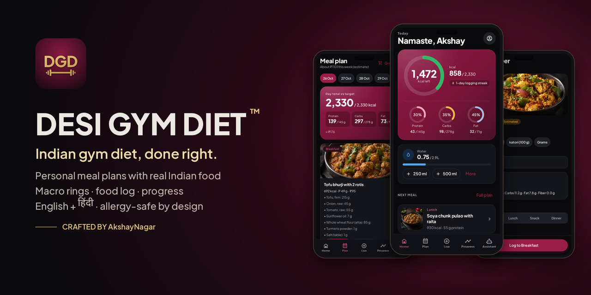
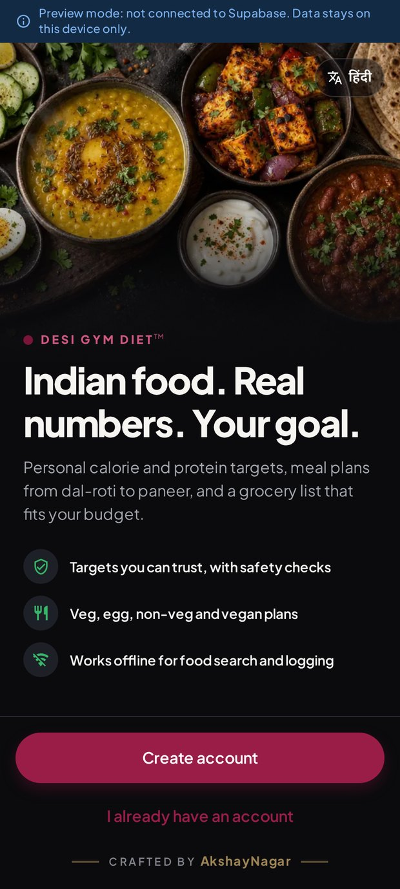
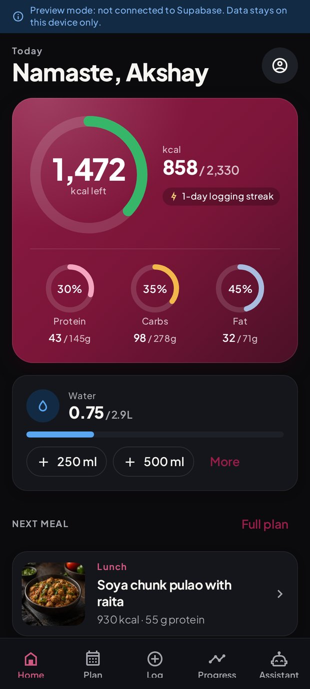
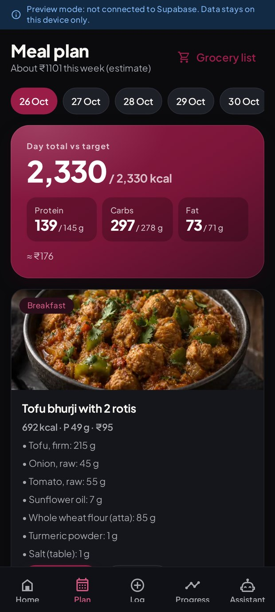
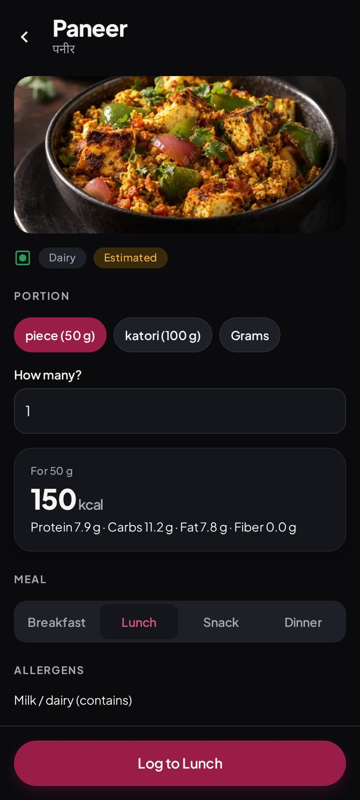
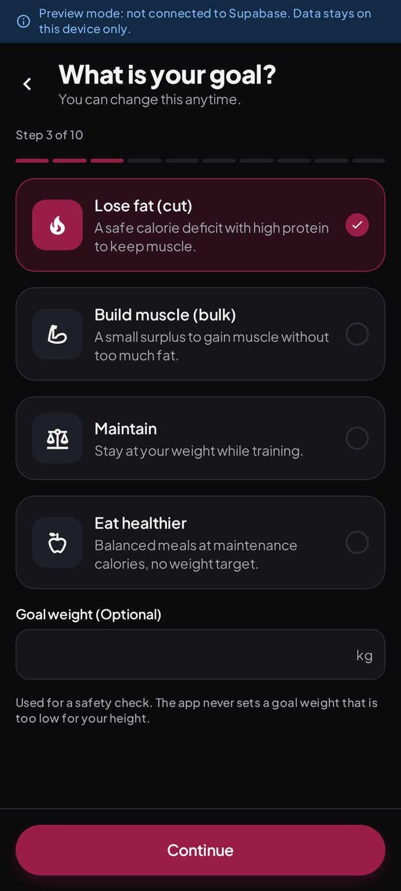
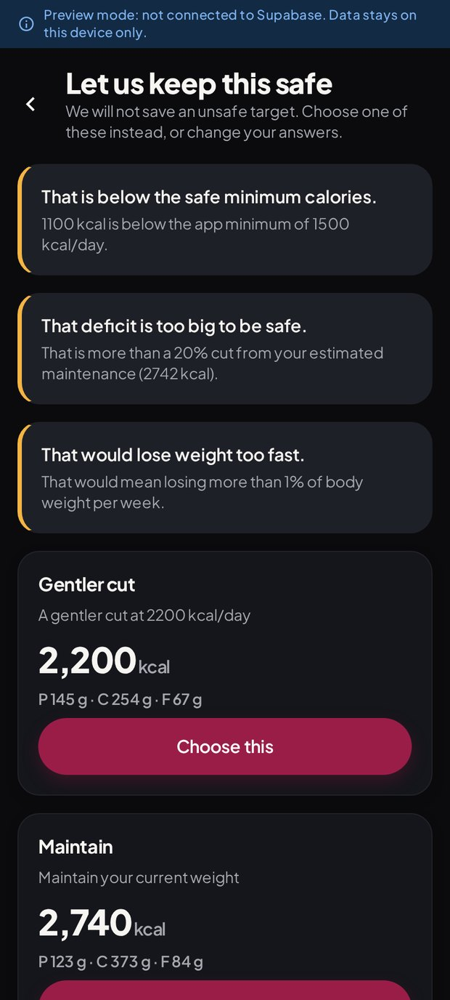
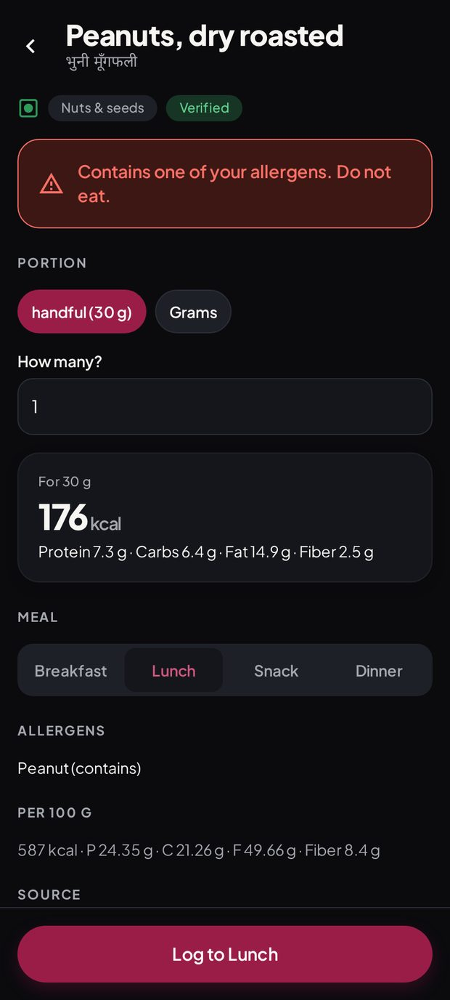
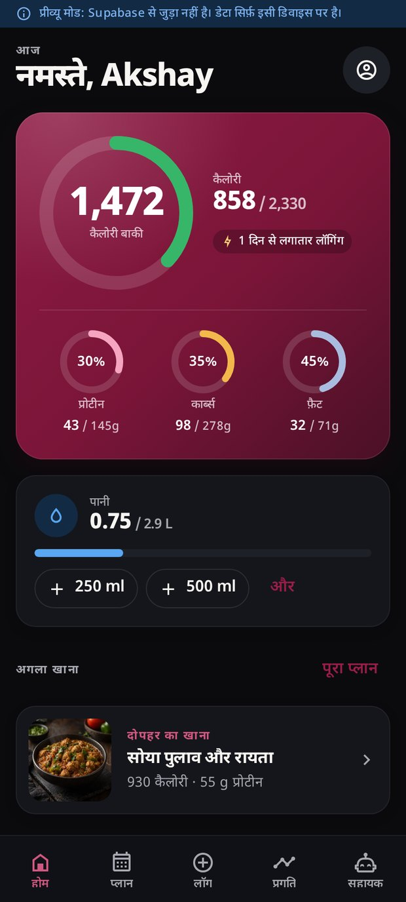

  

   
  <b>DESI GYM DIET™</b> 
  <i>Indian gym diet, done right. Real desi food, real macros, in English and हिंदी.</i>

  
  
  
  

  

<a href="https://github.com/iashwani69-code/desi-gym-diet-app/releases/latest/download/DesiGymDiet.apk"><b>⬇ Download Desi Gym Diet v1.0.3 (APK)</b></a>

  v1.0.3 · 86 MB · Android 7.0 or newer · <a href="https://github.com/iashwani69-code/desi-gym-diet-app/releases/latest">all releases</a>

---

## Why Desi Gym Diet

Most diet apps are built around foods you don't eat. **Desi Gym Diet** plans your gym diet with the food
already in an Indian kitchen: dal, roti, paneer, rajma-chawal, poha, curd, eggs, chicken and more.
It works out your calories and protein, builds the plan around them and keeps you on track.

## Features

- **Personal targets.** Calories, protein, carbs, fat, fibre and water, calculated from your body, goal and activity.
  Unsafe targets are refused, and you get safe alternatives to pick from.
- **Indian meal plans.** A weekly plan for 2–6 meals a day: veg, eggetarian, non-veg or vegan, within your budget and cooking time.
  Swap any meal for a safe alternative in one tap.
- **Allergy-safe by design.** Every plan, swap and grocery list is checked against your allergies.
  It also catches local names like “groundnut”, “jhinga” and “maida”.
- **Macro rings and food log.** See today's calories, protein, carbs and fat at a glance. Log food, water and weight.
- **Progress.** 7, 30 and 90-day trends for calories, protein, water and weight, plus streaks.
- **Food search in English, Hindi and Hinglish.** 140 foods and 346 Indian recipes, searchable offline (recipe nutrition is estimated from its ingredients).
- **Grocery list and pantry.** Built from your plan, minus what you already have.
- **English + हिंदी.** The whole app in both languages, switchable any time.
- **Premium dark design.** Black, maroon and gold, made to be easy on the eyes in the gym.

## Screenshots

<table>
  <tr>
    <td align="center"> Welcome</td>
    <td align="center"> Home: macro rings</td>
    <td align="center"> Indian meal plan</td>
    <td align="center"> Food detail</td>
  </tr>
  <tr>
    <td align="center"> Choose your goal</td>
    <td align="center"> Safe targets only</td>
    <td align="center"> Allergy warning</td>
    <td align="center"> हिंदी में</td>
  </tr>
</table>

## How to install on Android

1. On your Android phone, open **[Download APK](https://github.com/iashwani69-code/desi-gym-diet-app/releases/latest/download/DesiGymDiet.apk)**. Chrome downloads `DesiGymDiet.apk`.
2. Tap the downloaded file (or open it from **Files → Downloads**).
3. If Android asks, allow **Install unknown apps** for Chrome or your Files app. This is a one-time permission.
4. Tap **Install**, then **Open**.

> **“Play Protect” warning?** That's normal for apps installed from outside the Play Store. It appears because the app
> isn't on the Play Store yet, not because anything is wrong. Tap **More details → Install anyway**.

**Updating:** download the newer APK from [Releases](https://github.com/iashwani69-code/desi-gym-diet-app/releases/latest) and install it over the old one. Your data stays.

## Requirements

- Android **7.0 (Nougat) or newer**, on any modern phone (arm64 or armeabi-v7a)
- About 150 MB of free space
- A free account (just your email and a password)
- Internet for sign-up and sync; food search, logging, water and weight also work offline

## Current version: what to expect

**v1.0.1: login & cloud sync are live.** Create an account with your email and a password, and your profile, goals,
food log, water and weight are saved to your account. After signing up you'll get a confirmation email: open the link
on your phone (check Spam if you don't see it), then log in. The AI assistant is coming soon.

## Health disclaimer

Desi Gym Diet gives general fitness and nutrition guidance. **It is not medical advice.** Calorie, protein and other targets
are estimates, meant as guidance. If you are pregnant or breastfeeding, under 18, or have diabetes, kidney, heart or
any other medical condition or an eating disorder, talk to a doctor or a registered dietitian before changing your diet.

## Privacy

Your data is private to your account. Every table in the database is locked with Row Level Security, so each
account can only ever read and change its own data, and that was tested with two separate accounts before release.
No ads, no tracking, and nothing is sold. You can export your data or permanently delete your account from **Settings** at any time.

## Contact

Questions, feedback or a bug? Open an [issue](https://github.com/iashwani69-code/desi-gym-diet-app/issues) on this repository.

---

  <b>DESI GYM DIET™</b> · Crafted by <b>AkshayNagar</b> 
  © 2026 AkshayNagar. All rights reserved. The app and its source code are proprietary; see <a href="LICENSE">LICENSE</a>.

